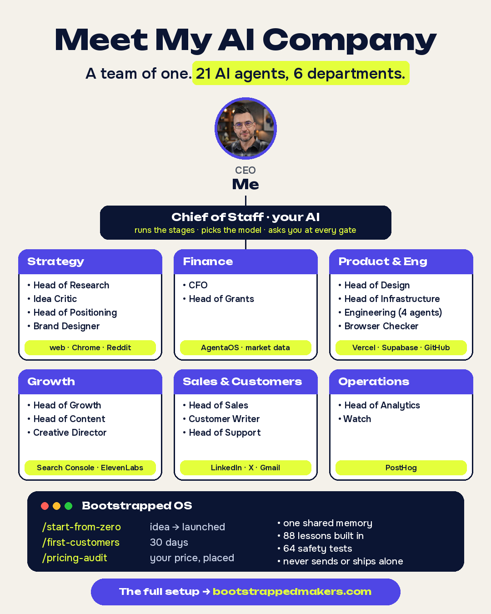

# Bootstrapped OS

**An AI team for your one-person business. They draft. You decide.**

A team of AI roles in six departments, run by a Chief of Staff. It takes a solo founder from a niche idea to a launched product that takes payments, then does the daily work of getting customers. It runs inside [Claude Code](https://code.claude.com) on your own AI plan.

It is the system I run my own payments company with. Open source, free to use. What it did for me: [`example-my-setup.md`](example-my-setup.md).



## Free and complete. Add your knowledge, or plug in mine.
- **Built in, free:** every role comes with proven steps. Install it and go.
- **Yours, free:** add your own notes, rules and numbers in `CLAUDE.md` and `knowledge/`. Every agent follows them first.
- **Mine, for members:** my knowledge on tap, inside your agents, updated every week:
  - **Get found on Google and ChatGPT:** my site's Google trust score went 5 → 33 in one month (6×), and AI named my product in 4 of 9 buyer questions
  - **First customers:** 25 of 90 people replied to my messages, 2 sales on launch day. The exact messages and follow-ups
  - **Funding:** $2M in grants raised for my last startup. The programs open now, with deadlines, and $300 in AI credits on day one
  - **AI team:** mine costs ~$5 a day and shipped 791 releases in 114 days. The setup and the lessons
  - **Mistakes to skip:** 629 notes of what went wrong, each with the reason

**It keeps getting better.** I run my company every day and keep adding what I learn. Your agents get it automatically, so they get better over time.

Members connect with [Bootstrapped Makers](https://bootstrappedmakers.com/bootstrapped-os?utm_source=github&utm_medium=readme#members). One key, new plays every week, nothing to update: [`CONNECT.md`](CONNECT.md). Without a key, the agents say "Bootstrapped core not connected" and carry on with the method.

The strongest lessons are free in [`plugins/bootstrapped-os/lessons/claude-md-starter.md`](plugins/bootstrapped-os/lessons/claude-md-starter.md), ready to paste into your `CLAUDE.md`.

## What's in it
Every role, with its agent, skills, commands, tools and model: [`OS.md`](OS.md). How the pieces fit, and how to add your own: [`ARCHITECTURE.md`](ARCHITECTURE.md).

- **Starting from zero?** `/start-from-zero` runs [the stages](plugins/bootstrapped-os/shared/stages.md) one at a time, from idea to first customers. You approve each one.
- **Already live?** `/day0` asks your revenue and starts you on the right roles.
- **Modules:** `bootstrapped-os-software` (build and ship, with a launch starter), `bootstrapped-os-growth` (page critique, funnel, SEO), `bootstrapped-os-video` (launch videos). Each one needs the core plugin.

## Safe by default
Agents read, draft and propose. Sending, publishing, deploying, merging, migrating, paying and wide deletes are blocked or ask you first. Hooks enforce this, and you can run the tests yourself: [`guides/00-how-agents-stay-safe.md`](guides/00-how-agents-stay-safe.md).

## One shared memory
`/day0` creates a `knowledge/` folder in your project: customers, decisions, rules, numbers, trackers, log. Every role reads it before a task and writes one line after. Plain markdown that you own.

## Install
Step by step, with what you should see: [`INSTALL.md`](INSTALL.md). Then your first day: [`guides/01-chief-of-staff.md`](guides/01-chief-of-staff.md).

## What it costs to run
An AI plan that runs Claude Code (from $20 a month) plus the free tiers of GitHub, Vercel, Supabase, Cloudflare and PostHog. My own setup: [`example-my-setup.md`](example-my-setup.md).

## Built on
Superpowers (obra), Anthropic's feature-dev and code-review plugins, coreyhaines31/marketingskills, Remotion's official plugin, and the PostHog, Notion and ElevenLabs connectors. Thank you to their authors. The full list: [`skills-i-use.md`](skills-i-use.md).

**Disclosure:** AgentaOS (payments) is my own company. The launch starter's checkout uses it; everything else works without it.

## Built something with it?
The launch starter's footer says "Made with Bootstrapped OS" (set `"madeWith": false` in `product.json` to remove it). Or add this to your README:

```markdown
[](https://bootstrappedmakers.com/bootstrapped-os?ref=badge)
```

Tell us in [Discussions](https://github.com/PancheI/BootstrappedOS/discussions) and we'll add you to the makers wall.

## Community
Follow along for updates:
- **Follow me on X:** [@PIsajeski](https://x.com/PIsajeski)
- **Mailing list and newsletter:** join free at [bootstrappedmakers.com](https://bootstrappedmakers.com/?utm_source=github&utm_medium=readme#hwl)
- **Live workshops,** with the replay after: [the last one on YouTube](https://youtu.be/QsFzF8122G0)
- **Questions and ideas:** [GitHub Discussions](https://github.com/PancheI/BootstrappedOS/discussions)
- **Founders' chat** for members, through [bootstrappedmakers.com](https://bootstrappedmakers.com/?utm_source=github&utm_medium=readme)

## Contributing
Issues and pull requests are welcome: [`CONTRIBUTING.md`](CONTRIBUTING.md). Security reports: [`SECURITY.md`](SECURITY.md).

## License
[MIT](LICENSE). "Bootstrapped OS" and "Bootstrapped Makers" are names of Bootstrapped Makers; forks should use their own name.

Made by [Panche Isajeski](https://www.linkedin.com/in/pan-i) · [bootstrappedmakers.com](https://bootstrappedmakers.com)
